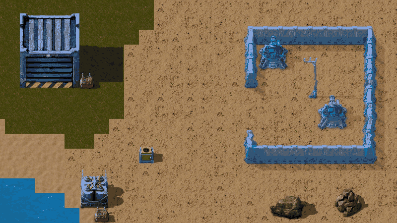
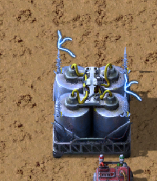
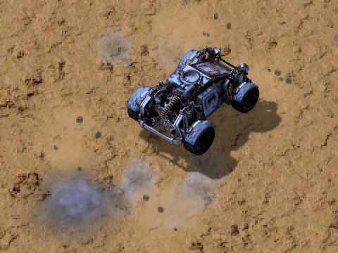
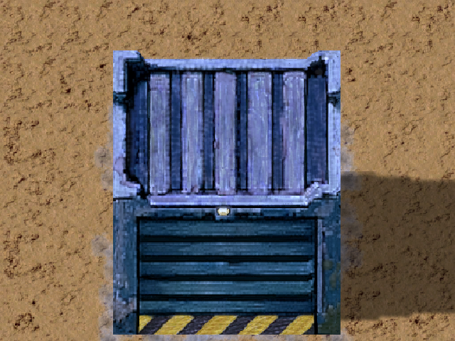
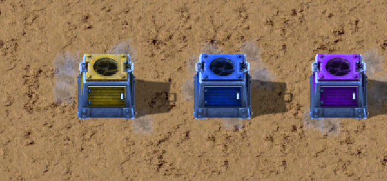

# Autonomous Car

*Français plus bas.*

Cars that build where your robots do not reach. Select ghosts, deconstruction or upgrade marks: the cars fetch the items from supply chests, do the work, bring back what is left, then recharge and park on their own.

Factorio 2.1. **Not tested with Space Age yet** (other planets, space platforms, quality), **nor in multiplayer**.

## Getting started

1. Research **Autonomous cars** (after Automobilism, Battery and Electric engine).

2. Place a **charger** on your electric network, a **garage** and a **supply chest**, and put the items to build in the chest.

3. Build a car and place it: it goes to charge first. Or put it in the first slot of the garage to park it.

4. Take the **autonomous car selector** (Alt+G, or its shortcut button) and drag it over ghosts and marked entities. What a robot network covers is left to the robots.

## What the cars do

- Build ghosts, including landfill (from the shore), deconstruct (trees, rocks, buildings, cliffs with a cliff explosive from a chest) and upgrade (entity or quality).
- Group the targets into batches, take the items, come back for what is missing, and bring back what is left and what they mined.
- Recharge at the chargers, burn a battery from the last trunk slot when nearly empty, park in a garage when idle, and flee enemies.
- Clear their way through trees and rocks when stuck (nothing is collected), never through buildings, walls or cliffs.

## Buildings and researches

- **Garage**: parks the cars; its slots refill the selected car with batteries and ammo; repairs the cars with repair packs once researched; a button gives a parked car back to you.

- **Supply chest**, plus after **Logistic system** a **delivery chest** (requests what the cars lack from your logistic network) and a **return chest** (cars empty their trunk there first, robots take it away).

- **Circuit network**: the small combinator by a garage or charger outputs parked cars, free places, health and charge, or the charger's buffer, power and users.
- **Researches**: cargo, garage places, cars per charger, charge speed, build speed. After **Military**, cars shoot with the ammo of their ammo slot.
- **Missing items** shortcut: what the cars are waiting for.

## Tips and limits

- Leave openings of at least 3 tiles in walls. Align the gates of successive walls, or space the walls at least 10 tiles apart.
- A car walled in stays stuck; it warns you, then gives up its batch (select the ghosts again).
- Bug reports are welcome in the Discussion tab of the mod portal. The command `/car-trace` writes a trace to `script-output` that helps a lot.

## Credits

The driving system is largely inspired by [Pavement Drive Assist](https://mods.factorio.com/mod/PavementDriveAssist) by Arcitos, the driving assistant that keeps a vehicle on paved roads.

License: MIT (see `LICENSE`). The graphics derived from those of Factorio remain the property of Wube Software.

**This mod was developed with extensive use of AI**.

---

# Voiture autonome

Des voitures qui construisent là où vos robots n'arrivent pas. Sélectionnez des fantômes ou des marques de démontage ou de mise à niveau : les voitures prennent les objets dans les coffres d'approvisionnement, font le travail, rapportent ce qui reste, puis se rechargent et se garent seules.

Factorio 2.1. **Pas encore testé avec Space Age** (autres planètes, plateformes spatiales, qualité), **ni en multijoueur**.

## Pour commencer

1. Recherchez **Voitures autonomes** (après Automobile, Batterie et Moteur électrique).
2. Posez un **chargeur** sur votre réseau électrique, un **garage** et un **coffre d'approvisionnement**, et mettez dans le coffre les objets à construire.

3. Fabriquez une voiture et posez-la : elle va d'abord se charger. Ou mettez-la dans le premier emplacement du garage pour la garer.

4. Prenez le **sélecteur des voitures autonomes** (Alt+G, ou son bouton de raccourci) et faites-le glisser sur des fantômes et des entités marquées. Ce que couvre un réseau de robots est laissé aux robots.

## Ce que font les voitures

- Construire les fantômes, remblai compris (depuis la rive), démonter (arbres, rochers, bâtiments, falaises avec un explosif de falaise pris dans un coffre) et mettre à niveau (entité ou qualité).
- Regrouper les cibles en lots, prendre les objets, revenir chercher ce qui manque, et rapporter ce qui reste et ce qu'elles ont démonté.
- Se recharger aux chargeurs, brûler une batterie du dernier emplacement du coffre quand elles sont presque vides, se garer quand elles n'ont rien à faire, et fuir les ennemis.
- Se dégager des arbres et des rochers quand elles sont bloquées (sans rien récupérer), jamais des bâtiments, murs ou falaises.

## Bâtiments et recherches

- **Garage** : gare les voitures ; ses emplacements rechargent la voiture sélectionnée en batteries et en munitions ; répare les voitures avec des kits de réparation une fois la recherche faite ; un bouton vous rend une voiture garée.

- **Coffre d'approvisionnement**, et après **Système logistique**, un **coffre de livraison** (demande à votre réseau logistique ce qui manque aux voitures) et un **coffre de retour** (les voitures y vident d'abord leur coffre, les robots l'emportent).

- **Réseau logique** : le petit combinateur à côté d'un garage ou d'un chargeur donne les voitures garées, les places libres, la santé et la charge, ou le tampon, la puissance et les voitures du chargeur.
- **Recherches** : capacité, places de garage, voitures par chargeur, vitesse de charge, vitesse de construction. Après **Militaire**, les voitures tirent avec les munitions de leur emplacement de munitions.
- Raccourci **Objets manquants** : ce que les voitures attendent.

## Conseils et limites

- Laissez des ouvertures d'au moins 3 tiles dans les murs. Alignez les portes de murs successifs, ou espacez les murs d'au moins 10 tiles.
- Une voiture emmurée reste bloquée ; elle vous prévient, puis abandonne son lot (sélectionnez de nouveau les fantômes).
- Les signalements de bugs sont bienvenus dans l'onglet Discussion du portail des mods. La commande `/car-trace` écrit une trace dans `script-output` qui aide beaucoup.

## Remerciements

Le système de conduite est inspiré de [Pavement Drive Assist](https://mods.factorio.com/mod/PavementDriveAssist) d'Arcitos, l'assistant de conduite qui garde un véhicule sur les routes pavées.

Licence : MIT (voir `LICENSE`). Les images tirées de celles de Factorio restent la propriété de Wube Software.

**Ce mod a été développé en utilisant largement l'IA**.
